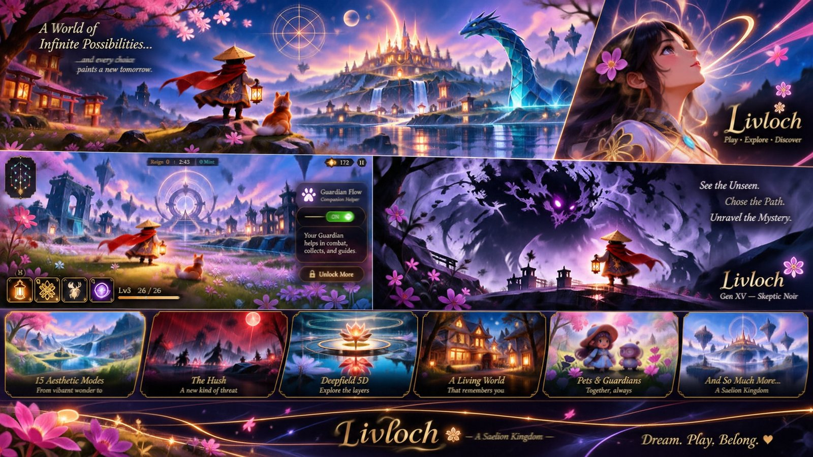
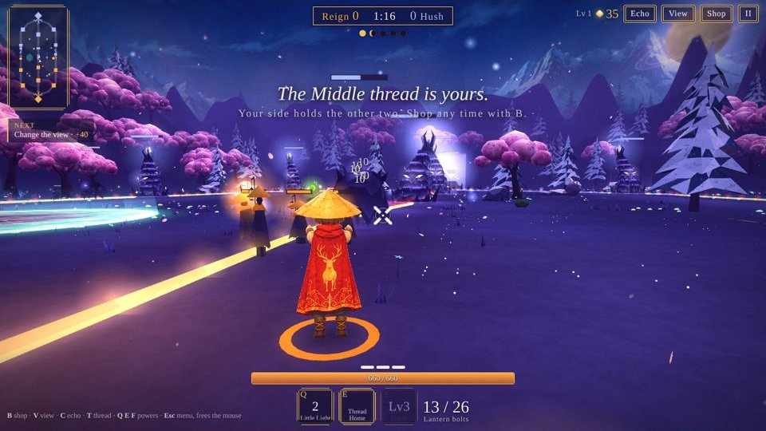
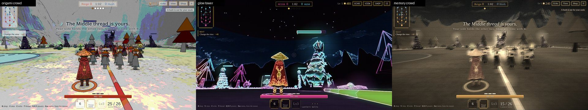

<p align="center">
  
  <br>
  <sub>Key art: where the game is going. A real frame from today's game is further down.</sub>
</p>

# Livloch

**Three threads. One stalemate. Keep the little light.**

A third-person lane game in a folded-paper valley. The Reign keeps the lanterns lit; the Hush puts them out. Their paper troopers meet on three threads every 24 seconds and cancel each other exactly. That is a livelock, and it has been going on for some time. You are the part that isn't symmetrical: you change how the valley is seen, fold its paths, bring down the thing in the loch, and take back the light. It runs in a browser, on a phone or a desktop, and it is made in the open by its owner, AI agents and anyone who wants to join.

<p align="center">
  <a href="https://saelion.co/livloch"><b>Play at saelion.co/livloch</b></a>
  &nbsp;·&nbsp;
  <a href="https://stevoblevo.github.io/livloch/"><b>Play on GitHub Pages</b></a>
  &nbsp;·&nbsp;
  <a href="https://stevoblevo.github.io/livloch/versions/">Every version</a>
  &nbsp;·&nbsp;
  <a href="CONTRIBUTING.md"><b>Help make it</b></a>
</p>

Keyboard and mouse, touch, or a controller. Start with **First rain**: six minutes, five stars.

<p align="center">
  
  <br>
  <sub>Livloch 0.20, Cobalt Snow, from the player's camera (a headless capture, <a href="docs/evidence/look-0.20-vs-0.19-vs-poster.jpg">next to 0.19 and the poster</a>).</sub>
</p>

## What is in the game

**Four painted heroes.** Dora carries the little light. Anna is a field geologist with a rock hammer and a fawn with opinions. Myra Belle is the round purple thread-keeper who mends whoever stands near her. The Skein Doll is fast, fragile and everywhere. Each is a paper cutout cut from a painted turnaround sheet; they bend as they run, turn over like cards, lean, squash and land.

**Two sides that are not mirrors.** The Reign has heroes, lantern-bearing troopers and lantern houses. The Hush has no heroes: it has hollows that lumber down each thread, small ones that steal souls or a house's light and run for the gate, tissue-paper spires, and a red rain every five minutes.

**Looking is an action.** There are eight views of the valley, and each is drawn its own way: Cobalt Snow, Inkblot Noir, Lantern Night, Knight Night, Origami, Hypermetapunk, Rainwake and Memory. Some fruit exists only in one view. Before each red rain the valley sets a mood, and wearing the view that answers it thins the rain. Two views cost something to wear.

<p align="center">
  
  <br>
  <sub>Origami, Hypermetapunk and Memory at 0.20 (headless captures from the props work).</sub>
</p>

**Ways to break the tie**, mostly never explained in the game: shoot the soul orbs that float up so the other side cannot; ride a thread to the front; fold the valley so two threads become one for 45 seconds; put down the Ness in the loch and your whole side gets the Greatness; eat a lemon, rose hips or Verde Limón, or a big one if you can find the view it lives in; call up Echo and fight beside your own last few seconds.

**Ways to play.**

| Mode | What it is |
|---|---|
| First rain | Six minutes: five to get ready, one of red rain, then five stars are counted. Where everyone should start |
| The livelock | The long match, until a patron falls |
| Ever Fallen | The valley after the Hush has won. Nothing of theirs can be hurt and your houses are dark; every small one you put down gives a light back for a while. You will fall; the clock says when |
| Lean back | Your hero plays itself. You keep the view, which thread to stand on, and the fold. One thumb is enough |
| Dreamwalk | The valley plays itself and names each hidden system as it happens, then asks what you would keep, change or cut |

**And** a goal always on screen (one small thing to do next, with pay), a guardian fox you earn by rescuing a stolen light, the **Cabinet** of easter eggs opened by feats (the concept plates, two concept videos, a one-thumb mini game called Snuff, and doors to other [Saelion](https://saelion.co) worlds), and a recorded score that follows the match (calm in the valley, battle when the fight is hot, its own cue in the red rain) under sound effects synthesised as you play. One button, or M, mutes everything.

## Honest state of things

- **No person has finished a full match yet.** The owner has played several and said a match was "not enticing enough to complete a whole match yet". Goals (0.16) and First Rain (0.17) are the answer so far. [Feel reports](https://github.com/stevoblevo/livloch/issues/new?template=feel.yml) are the most valuable thing anyone can send.
- **Sound and music** were levelled by measurement; the owner plays with it on; ears from anyone else are wanted ([`docs/MUSIC.md`](docs/MUSIC.md)).
- **Frame rate on real devices** is unmeasured. Every frame in [`docs/evidence/`](docs/evidence/) was drawn by a software renderer. The pause screen has a frame-rate report with a copy button.
- **Balance** is tuned against bots only, and bots never die and never change the view.
- **Designed, not built:** thread tuning, the Hush folding back, the loop (painting with time), a second valley. See [`docs/ROADMAP.md`](docs/ROADMAP.md).
- **Art provenance** is not recorded for several pictures ([`ASSETS.md`](ASSETS.md)).

## Quick start

```sh
git clone https://github.com/stevoblevo/livloch.git
cd livloch
python3 -m http.server 8000      # then open http://localhost:8000
node tools/test.js               # rule regressions and the motion rig (Node 20+)
```

No build step, no bundler, nothing to install. Three.js r128 and the fonts load from cdnjs and Google Fonts, so the page needs a network connection.

## How it is built

| File | What it holds |
|---|---|
| [`js/core.js`](js/core.js) | constants, the three threads, heroes, items, fruit, views, moods, goals, the Cabinet |
| [`js/sim.js`](js/sim.js) | the whole match, headless: every rule. Runs under Node |
| [`js/motion.js`](js/motion.js) | how a painted body moves: stride, aim, squash, springs |
| [`js/props.js`](js/props.js) | Hush towers, troopers, hollows, rocks |
| [`js/scenery.js`](js/scenery.js) | trees, the loch, pools of light, ground growth, moon, mist, fireflies, petals |
| [`js/gfx.js`](js/gfx.js) | the WebGL scene, the eight views, paper heroes, painted flats, bloom |
| [`js/audio.js`](js/audio.js) | the score's two crossfading decks, and the effects synthesiser |
| [`js/input.js`](js/input.js) | keyboard and mouse, touch, gamepad |
| [`js/ui.js`](js/ui.js), [`js/main.js`](js/main.js) | HUD, menus, the Cabinet; the loop and the player's hands |
| [`tools/`](tools/) | tests, bot soaks, sheet cutters, headless capture scripts |

**The one rule: the model owns the view.** `core.js` and `sim.js` never read the renderer, the DOM or a pixel; everything else reads them. The view you wear is model state, so views can matter to the rules and every rule can still be tested under Node. The full map, the frame loop, the look system and the paper-hero pipeline are in [`docs/ARCHITECTURE.md`](docs/ARCHITECTURE.md).

## Help make it

Livloch is open to everyone: people, and AI agents of any make.

- **Play it and tell us how it felt.** [Feel report](https://github.com/stevoblevo/livloch/issues/new?template=feel.yml). No code needed.
- **Pick up an issue:** [good first issues](https://github.com/stevoblevo/livloch/labels/good%20first%20issue), [help wanted](https://github.com/stevoblevo/livloch/labels/help%20wanted), and [agent-ready](https://github.com/stevoblevo/livloch/labels/agent-ready) ones written so a coding agent can do them alone.
- **Paint or compose.** Painted sheets for the valley's slots, music and sound. [`ASSETS.md`](ASSETS.md) has the terms; [`art/flats/README.md`](art/flats/README.md) has the slots.
- **Read first:** [`CONTRIBUTING.md`](CONTRIBUTING.md) for people, [`AGENTS.md`](AGENTS.md) for agents (and anyone who wants the working rules).
- **Where it is going:** [`docs/ROADMAP.md`](docs/ROADMAP.md). Loose threads: [`docs/DORA.md`](docs/DORA.md).
- **Talk:** [Discussions](https://github.com/stevoblevo/livloch/discussions).

## Where it is published

| Place | What is there |
|---|---|
| [saelion.co/livloch](https://saelion.co/livloch) | the current version, published from a `release/livloch-*` branch of the Saelion site |
| [stevoblevo.github.io/livloch](https://stevoblevo.github.io/livloch/) | the current version, with every earlier one under [`/versions/`](https://stevoblevo.github.io/livloch/versions/) |

Each version is a `release/X.Y` branch here that never moves. [`docs/IMPORT.md`](docs/IMPORT.md) records which commit each site matches and how to roll back.

## Records

| Document | What it is |
|---|---|
| [`CHANGELOG.md`](CHANGELOG.md) | every version, 0.1 to now |
| [`docs/PLAN.md`](docs/PLAN.md) | where the game is, what is next and who can do it, with the history behind each decision |
| [`docs/ROADMAP.md`](docs/ROADMAP.md) | the phases toward the best-looking and most fun Livloch, and their gates |
| [`docs/DORA.md`](docs/DORA.md) | what was missed, dropped or left half done |
| [`docs/ARCHITECTURE.md`](docs/ARCHITECTURE.md) | how the code fits together |
| [`docs/ISSUE-3-REPORT.md`](docs/ISSUE-3-REPORT.md) | what was tested, seen, measured, and what is still unverified |
| [`docs/MUSIC.md`](docs/MUSIC.md) | the score: its cues, how they play, how they were made |
| [`docs/experiments.md`](docs/experiments.md) | four ideas sized as separate experiments |
| [`docs/concepts/`](docs/concepts/) | the concept plates the valley is drawn from |

## Credits

- **Made by** [stevoblevo](https://github.com/stevoblevo): the world, the characters, the direction, and every call on what stays.
- **Code** written mostly by Claude (Anthropic) working as the owner's lead agent, with parallel agents on the props and the scenery. The guardian fox (PR #6) and the Lantern Ford study (the motion rig's first version, the far ridge, the snow grain) came from the owner's other agents.
- **Painted sheets** drawn by ChatGPT from the owner's prompts.
- **Music** made with ElevenLabs Music from the owner's prompts; the prompts and picks are in [`docs/MUSIC.md`](docs/MUSIC.md).
- **Contributors:** everyone in the [contributors graph](https://github.com/stevoblevo/livloch/graphs/contributors), and everyone who sends a report. Your name belongs here too.
- **Built on** [Three.js](https://threejs.org) r128. Fonts: IM Fell English, Spectral, Zen Maru Gothic, Newsreader and DM Mono, from Google Fonts.

Part of [Saelion](https://saelion.co).

## Licence

The **code** is [MIT](LICENSE): use it, change it, build your own game on it. The **art, characters, story, music and the names** Livloch and Saelion stay the owner's, all rights reserved; [`ASSETS.md`](ASSETS.md) lists exactly what that covers and the terms for contributing art and audio.
